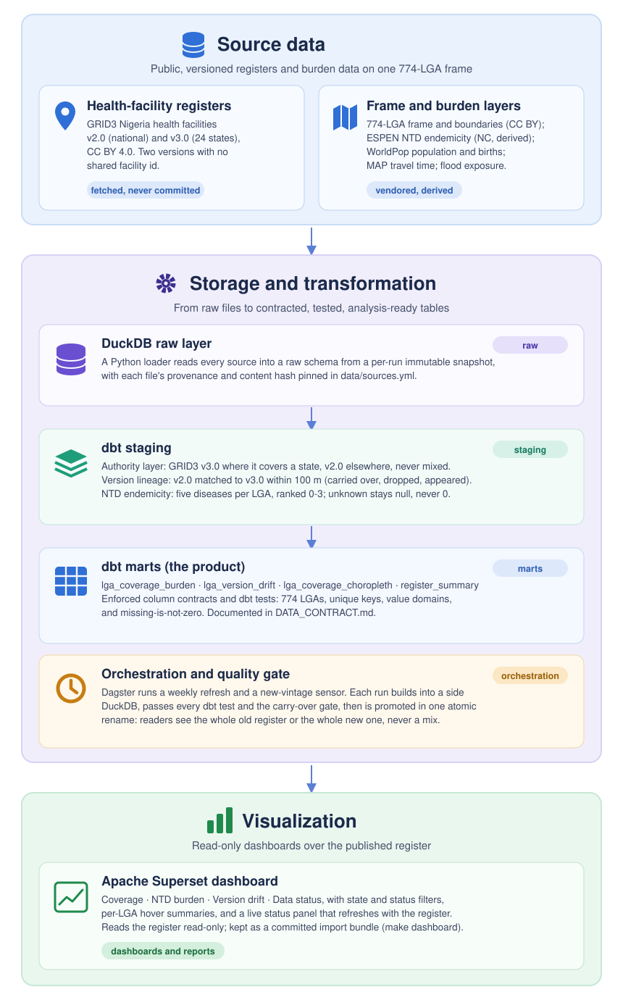

# Nigeria Facility Register

[](https://github.com/Behordeun/nigeria-facility-register/actions/workflows/ci.yml?query=branch%3Adevelopment)
[](https://github.com/Behordeun/nigeria-facility-register/actions/workflows/ci.yml?query=branch%3Amain)
[](https://github.com/Behordeun/nigeria-facility-register/commits/development)
[](https://github.com/Behordeun/nigeria-facility-register/commits/development)
[](https://github.com/Behordeun/nigeria-facility-register/commits/development)
[](https://github.com/Behordeun/nigeria-facility-register/commits/development)
[](https://github.com/Behordeun/nigeria-facility-register/releases/latest)
[](LICENSE)
[](pyproject.toml)

The CI badges track the build workflow on each branch: lint, unit tests, the SonarCloud scan and the sample dbt build. The SonarCloud, GitGuardian and Amazon Q badges show each check's result on the latest `development` commit (the SonarCloud quality gate, the GitGuardian secret scan and the automated code review), and "All checks" turns red if any check there fails.

A version-aware health-facility register for Nigeria, built from GRID3's published releases and composed with neglected-tropical-disease burden at LGA resolution.

GRID3 publishes its health-facility data in versions that cover different states and share no common identifier. v2.0 is national (51,022 facilities, to October 2024). v3.0 covers 24 states (41,778 facilities, to December 2025) and supersedes v2.0 in those states. This project keeps each state on its most current version, reconstructs how facilities change between versions, and joins the result to disease burden.

## What it produces

- A single authoritative facility layer that switches source per state: v3.0 where it exists, v2.0 elsewhere. Every row records its source version and whether that state's data is current or stale.
- A v2-to-v3 lineage table. The two versions share no carry-over id (v2 keys on `globalid`, v3 on `unique_id`), so lineage is rebuilt by spatial and name matching. 89.8% of v2.0 facilities match a v3.0 point within 100 m, with 89.9% name agreement.
- A per-LGA table joining facility coverage to burden and population: facility counts, facilities per 10,000 people, the mix of primary, secondary and tertiary facilities and the share recorded as not functional (WorldPop, rolling forward each calendar year through 2030), the ESPEN endemicity rank of five neglected tropical diseases, the state-level soil-transmitted-helminths share, travel time to the nearest facility and flood exposure with a 0-2 access risk score, and a 0-11 priority score (high, medium or low) that adds burden, per-capita coverage, access and malaria, beside the original flag for LGAs where burden is high and coverage is thin.
- A one-row register summary and a Superset dashboard over the published tables (coverage with a ranked priority list, a one-LGA profile, facility mix, NTD burden, access, a 2025-2030 population outlook, version drift, and a live data-status page).

## How it is built



A loader reads each source file into DuckDB as a `raw` table. Staging builds the version-aware authority layer and the v2-to-v3 match. Marts join coverage to burden on the 774-LGA frame. dbt tests enforce the contract: one source version per state, unique facility ids, no silent zeros. The whole thing runs locally on DuckDB and dbt.

## Layout

```text
src/nfr/          Python: name keys, source loader, Dagster orchestration
dbt/              DuckDB models: staging (authority layer, version lineage, per-LGA NTD endemicity), marts (coverage x burden, version drift, choropleth), seeds (endemicity rank map)
data/frame/       774-LGA index + centroids + simplified boundary polygons (CC BY)
data/derived/     derived per-state and per-LGA ESPEN NTD summaries (CC BY-NC-SA, non-commercial),
                  per-LGA flood exposure (NASA, open), WorldPop births (CC BY), and per-LGA
                  population with travel time to healthcare, and malaria parasite rate and
                  incidence (WorldPop + Malaria Atlas Project, CC BY)
data/raw/         fetched geopackages (gitignored, see data/sources.yml)
scripts/          fetch_sources.py, build_lga_geometry.py, build_enrichment_sources.py,
                  build_access_population.py, build_malaria_burden.py, superset_dashboard.py
superset/         Superset image and config (server-side downloads), and the dashboard import bundle
tests/            unit tests (join keys, loader guards, orchestration, derived inputs, dashboard bundle)
```

## Run it

Try it without any download, on the committed two-state sample:

```bash
make setup                     # venv + deps
make sample                    # load data/sample + build staging + marts + run tests
```

Run the full national register from the real inputs:

```bash
make setup                     # venv + deps
# download the two GRID3 geopackages in a browser (links in data/sources.yml), then
# place both as a set (use the venv python so pyogrio is available):
.venv/bin/python scripts/fetch_sources.py --place \
    ~/Downloads/nga_health_facilities_v2_0.gpkg \
    ~/Downloads/grid3_nga_health_facilities_v3_0.gpkg
make fetch                     # verify they are present and valid
make build                     # load sources + dbt staging + marts
make test                      # unit + dbt tests
```

The raw geopackages are fetched, not committed. HDX serves them behind a challenge that blocks scripted download, so download them in a browser using the links in `data/sources.yml`. Place the downloads with `scripts/fetch_sources.py --place <files>` (run it with the venv's Python, `.venv/bin/python`, so `pyogrio` is on the path). It validates each file is a complete, readable GeoPackage, then places a copy into `data/raw/` with an atomic rename, so the loader and the refresh sensor never see a half-written file. Pass both geopackages to one `--place` so they land as a consistent set rather than one new file beside one old one; your original downloads are left untouched.

## Data honesty

- Missing is not zero: a stale state, an unsurveyed ESPEN IU, and an LGA whose name did not join are each reported, never counted as zero. About 97% of facilities join to an LGA; the rest are flagged for name reconciliation.
- Dropped and appeared facilities between versions are review queues, not verdicts.
- NTD burden is state-level and broadcast to each LGA in the state, labelled as such.

## Data contract

The published marts carry a written, tested contract: column types are enforced by dbt model contracts, and the guarantees a type cannot express (grain, keys, "missing is not zero", value domains, freshness) are enforced by tests. See `docs/DATA_CONTRACT.md`.

## Deployment

The dev and CI loops need only `uv` and the lockfile. For an always-on deployment where the Dagster schedule and sensor keep refreshing the register, a `Dockerfile` and `docker-compose.yml` run the Dagster webserver and daemon from one image, sharing the instance and the built database. See `docs/DEPLOYMENT.md`.

## Licensing

Code is AGPL-3.0-or-later (`LICENSE`): you may use, modify and self-host it, and a modified version offered as a network service must publish its source under the same license. Derived data artifacts from CC BY sources are CC BY 4.0. The ESPEN NTD summaries carry the upstream CC BY-NC-SA 3.0 IGO non-commercial terms; the WorldPop births table is CC BY 4.0 and the flood-exposure table derives from open NASA data. Raw inputs are not redistributed. See `LICENSE-DATA` and `data/ATTRIBUTION.md`.
