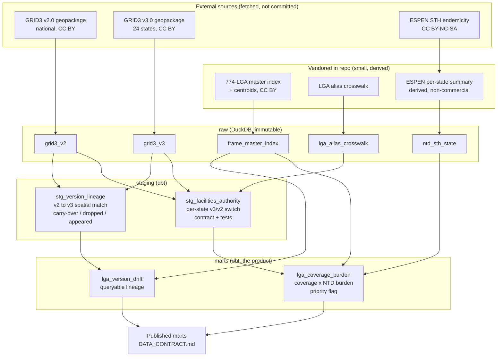
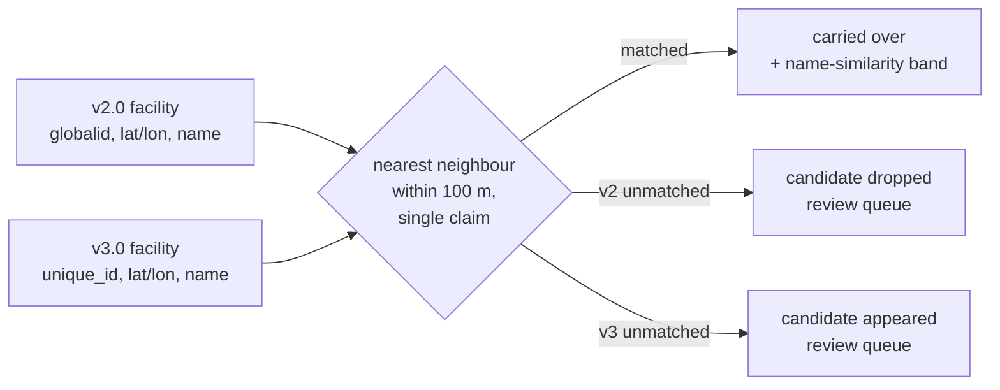
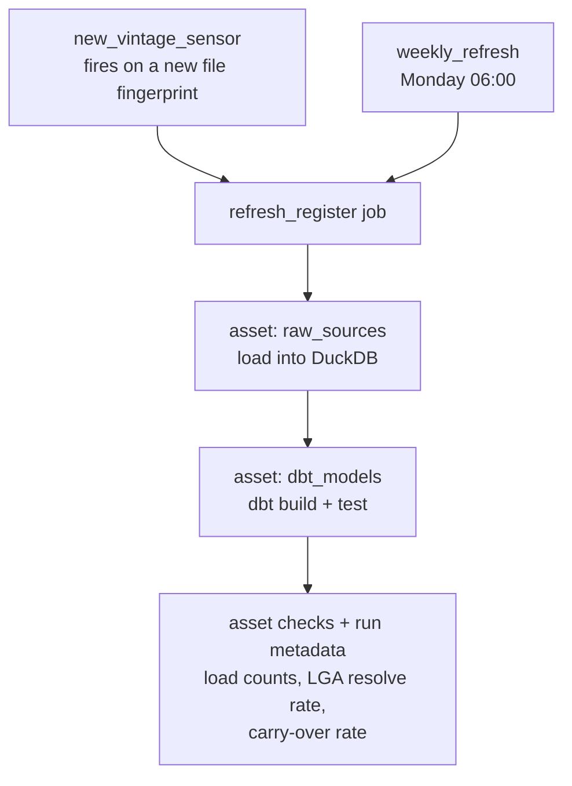

# Architecture

The pipeline turns Nigeria's versioned, conflicting health-facility registers into one point-in-time authoritative layer, tracks how facilities change between register versions, and joins coverage to disease burden at LGA resolution. It runs locally on DuckDB and dbt, orchestrated by Dagster.

## Data flow

## Spatial matching (why lineage needs it)

v2.0 keys on `globalid`, v3.0 on `unique_id`. The two versions share no carry-over id and the NHFR bridge code is too sparse in v3.0, so a facility's lineage across versions is reconstructed by position and name.

## Orchestration and run lifecycle

The new-vintage sensor fires only when the raw inputs differ from the vintage the live database was last built from. It waits until every raw input is present (so it never runs on a half-applied set of one new file beside one still-missing one), then settles across two ticks rather than sleeping inline: the first tick that sees a new fingerprint records it in the cursor, and the sensor acts only once the same fingerprint persists on a later tick, so a file still being written changes the fingerprint between ticks and never fires. (An inline sleep would block Dagster's shared sensor daemon thread.) The decision itself compares the settled fingerprint to a published-vintage sentinel: the promote step records, inside the live database, the fingerprint it built from, and the sensor fires only when the current inputs differ from it. Making the live database the authority — rather than querying run history — dissolves the awkward cases: a failed or still-queued run records nothing, so the vintage stays eligible; a scheduled or manual run that promotes also updates the sentinel, so the sensor sees it regardless of launch path; and a restored older vintage differs from what is live, so it rebuilds rather than leaving stale data published. The sensor also skips while a refresh is already queued or running, so its per-tick run key does not stack duplicates. A run-failure sensor records a failed refresh for operators; the re-fire comes from the sentinel comparison, not a cross-sensor cursor write.

A run does not read the live `data/raw/` directly. At the start of a run, `raw_sources` copies the inputs into a run-scoped immutable snapshot under `build/snapshots/<run id>/` (each file copied through a temp name and atomically renamed) and the loader reads the snapshot, so a change to `data/raw/` after the run starts cannot alter what it builds. When the sensor launched the run for a specific fingerprint, the snapshot's fingerprint is verified against that tag and the run fails fast on a mismatch, so a vintage that changed between the sensor's check and the load is never published under the old fingerprint. The published-vintage sentinel records the snapshot's fingerprint, the bytes actually built, and the snapshot is cleared when the run finishes.

Every refresh emits its own figures as Dagster run metadata: raw v2/v3 load counts on `raw_sources`, and authority and lineage row counts plus the LGA resolve rate (coverage and drift) and the carry-over rate on `dbt_models`. Two asset checks read the same figures and warn, rather than fail the run, when the coverage resolve rate or the carry-over rate falls below an advisory floor: those floors sit well under the rates a healthy vintage produces, so a warning means a crosswalk regression or a bad load, not normal variation. The resolve rate is measured among the states the vintage actually loaded, not against all 774 LGAs, so it reads the same on a two-state sample as on a national load, and the state label is normalised on both sides of that comparison so FCT is never dropped by a spelling mismatch. The carry-over rate is measured against the v2.0 facilities that could carry forward (every v2.0 facility in a v3-covered state, counted before the lineage model applies its id and coordinate guards), so a facility lost to a bad load shows up as a fall in the rate rather than disappearing from both sides of a lineage-only ratio. A rate whose denominator is zero is reported as not-applicable and never trips a floor.

## Layer contracts

| Layer | Holds | Guarantee |
| --- | --- | --- |
| raw | source tables loaded as-is | immutable, reload is idempotent, provenance + hash pinned, loaded from a per-run snapshot not the live directory |
| staging | authority layer, version lineage | one source version per state, unique facility id, crosswalk-resolved LGA |
| marts | coverage-burden, version drift, coverage-choropleth | one row per LGA, missing is not zero, enforced column contract (DATA_CONTRACT.md); the choropleth carries each LGA's boundary polygon for mapping |

## Data-quality gate

The gate is the layer that fails a build or a run, as distinct from the observability checks that only warn. Two kinds of failure are blocking.

dbt tests fail the build on a structural fault. The raw inputs are within row-count bounds: the frame's distinct normalised (state, LGA) key count must be exactly 774, and the facility and reference tables must clear a realistic lower bound on a production refresh (a modest floor on the sample build) so a truncated-but-non-empty load is caught rather than passing a bare "more than zero" check. The frame, the alias crosswalk and the NTD burden table are each unique on their normalised key, so a duplicate frame LGA, a duplicate source alias, or a duplicate burden row cannot pass by preserving a total while corrupting the logical set — a second burden row for a state would otherwise multiply every LGA in that state through the coverage join. The crosswalk source key must also be non-null, since a null never joins. Every LGA the version-drift mart resolves is a real frame LGA, and every state the NTD burden table and the alias crosswalk carry is a real frame state. The crosswalk check matters most, because the crosswalk is the one place a canonical LGA name is typed by hand, so a typo there would otherwise route a facility to an LGA that does not exist. All of these normalise the state label on both sides, so FCT is matched across the frame's "Federal Capital Territory" and the normalised "FCT" rather than failing as a false orphan, and every anti-join is written with NOT EXISTS, so a null on either side cannot make the check pass silently.

A refresh never builds in the live database. Both assets build into a run-scoped side DuckDB file under build/staging/: the loader writes the raw tables there, dbt builds the models and runs its data-quality tests against it, and the carry-over gate is checked against it. Only after the whole build, every dbt test and the gate pass is the side file promoted onto the live path in one atomic rename (os.replace, which is atomic within a filesystem, and build/staging and the live file share the build/ tree). So a reader of the live database sees either the whole previous register or the whole new one, never a half-built, partially-tested, or gate-rejected mixture. On any failure the side file is discarded and the live database is left untouched.

The carry-over gate fails the run when the match collapses. It is enforced inside the dbt_models asset, not as a blocking asset check: a blocking check only stops assets downstream of its target, and dbt_models is terminal, so the run would otherwise report success while serving a broken lineage. After the staged build the asset computes the carry-over rate and raises when it falls below a hard floor set well under the advisory warn floor; a rate that is undefined because the load produced no comparable v2.0 population is treated as a failure too, since unmeasured is not acceptable. Because the gate runs before the promote, a rejection simply means the side file is discarded and never promoted, so the live register is never touched; there is no rejected data to clean up. A non-blocking asset check reports the gate's verdict against the hard floor on every completed build, so a consumer reading asset-check results sees whether the gate passed, while the in-asset raise remains the hard stop that fails the job on a collapse. A dip warns (the observability check); a collapse blocks. The warn and gate floors are ordered so a vintage warns before it ever blocks.

## Boundaries that hold

- Raw third-party data is fetched, never committed. Derived outputs are Produced Works. A downloaded geopackage enters data/raw/ through `scripts/fetch_sources.py --place`, which validates it opens as a geopackage and moves it in with one atomic rename, so the loader and the new-vintage sensor never read a half-written file at the final path.
- ESPEN content stays non-commercial; only the derived per-state summary ships.
- Missing is not zero at every layer: a stale state, an unsurveyed IU, an unmatched LGA is an absence, never a measured zero.
- Every published mart has a written, tested contract before it is called done.
