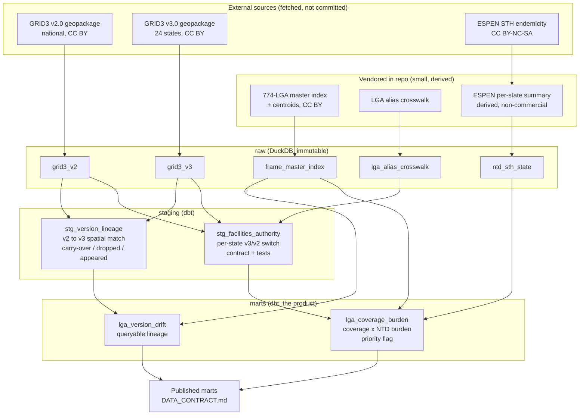
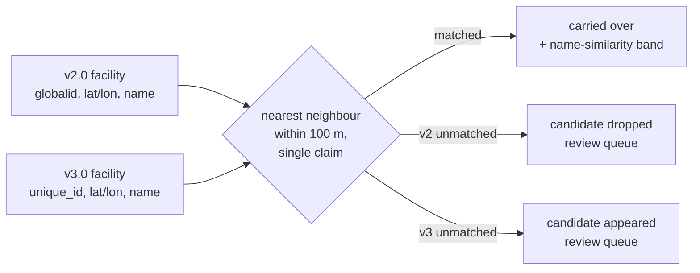
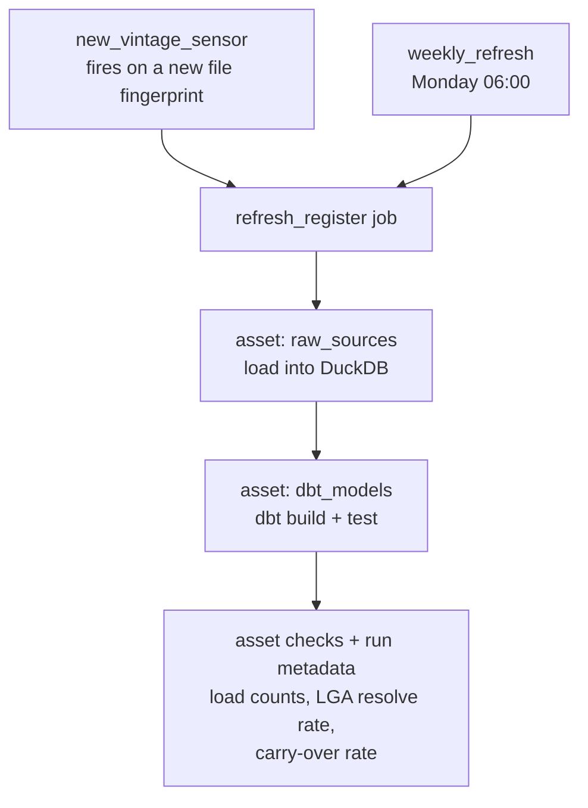

# Architecture

The pipeline turns Nigeria's versioned, conflicting health-facility registers into one point-in-time authoritative layer, tracks how facilities change between register versions, and joins coverage to disease burden at LGA resolution. It runs locally on DuckDB and dbt, orchestrated by Dagster.

## Data flow

## Spatial matching (why lineage needs it)

v2.0 keys on `globalid`, v3.0 on `unique_id`. The two versions share no carry-over id and the NHFR bridge code is too sparse in v3.0, so a facility's lineage across versions is reconstructed by position and name.

## Orchestration and run lifecycle

Every refresh emits its own figures as Dagster run metadata: raw v2/v3 load counts on `raw_sources`, and authority and lineage row counts plus the LGA resolve rate (coverage and drift) and the carry-over rate on `dbt_models`. Two asset checks read the same figures and warn, rather than fail the run, when the coverage resolve rate or the carry-over rate falls below an advisory floor: those floors sit well under the rates a healthy vintage produces, so a warning means a crosswalk regression or a bad load, not normal variation. The resolve rate is measured among the states the vintage actually loaded, not against all 774 LGAs, so it reads the same on a two-state sample as on a national load, and the state label is normalised on both sides of that comparison so FCT is never dropped by a spelling mismatch. The carry-over rate is measured against the v2.0 facilities that could carry forward (every v2.0 facility in a v3-covered state, counted before the lineage model applies its id and coordinate guards), so a facility lost to a bad load shows up as a fall in the rate rather than disappearing from both sides of a lineage-only ratio. A rate whose denominator is zero is reported as not-applicable and never trips a floor.

## Layer contracts

| Layer | Holds | Guarantee |
| --- | --- | --- |
| raw | source tables loaded as-is | immutable, reload is idempotent, provenance + hash pinned |
| staging | authority layer, version lineage | one source version per state, unique facility id, crosswalk-resolved LGA |
| marts | coverage-burden, version drift | one row per LGA, missing is not zero, enforced column contract (DATA_CONTRACT.md) |

## Data-quality gate

The gate is the layer that fails a build or a run, as distinct from the observability checks that only warn. Two kinds of failure are blocking.

dbt tests fail the build on a structural fault: the raw inputs are within row-count bounds (the frame is exactly 774 LGAs, the facility and reference tables are non-empty), every LGA the version-drift mart resolves is a real frame LGA, and every state the NTD burden table and the alias crosswalk carry is a real frame state. The crosswalk check matters most, because the crosswalk is the one place a canonical LGA name is typed by hand, so a typo there would otherwise route a facility to an LGA that does not exist. All of these normalise the state label on both sides, so FCT is matched across the frame's "Federal Capital Territory" and the normalised "FCT" rather than failing as a false orphan.

A blocking Dagster asset check fails the run when the carry-over rate collapses below a hard floor well under the advisory warn floor. A dip warns; a collapse (the spatial match broken by a coordinate or projection change, a key swap) blocks, so the broken lineage is never served. The warn and gate floors are ordered so a vintage warns before it ever blocks.

## Boundaries that hold

- Raw third-party data is fetched, never committed. Derived outputs are Produced Works.
- ESPEN content stays non-commercial; only the derived per-state summary ships.
- Missing is not zero at every layer: a stale state, an unsurveyed IU, an unmatched LGA is an absence, never a measured zero.
- Every published mart has a written, tested contract before it is called done.
